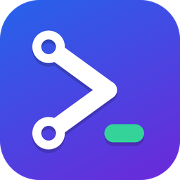

# DevDeck



A native, ultra-light Windows Git client modeled on the VS Code **Source Control** view.
It is built for running many instances at the same time with almost no memory or CPU cost.

- **Stack:** Rust + raw Win32 + GDI (`windows-sys` is the only dependency). It has no runtime, no web view, no GPU context and no garbage collector.
- **Git:** runs `git.exe` (porcelain v2), so it respects your git config, hooks and Git Credential Manager.

## Measured footprint

Measured on the same demo repository, Windows 11:

| | DevDeck | Electron version |
|---|---|---|
| On disk | **0.8 MB** single `.exe` | ~357 MB (Electron runtime) + app |
| Processes per window | **1** | 4 |
| Private memory | **2.7 MB** | 253 MB |
| Working set | **16 MB** | 390 MB |
| CPU while idle (10 s) | **0 ms** | - |
| Repo with 5,000 changed files / 300 commits | 3.9 MB private, 0 ms idle CPU | - |

Why it stays light:
- File changes are detected with `ReadDirectoryChangesW` on a thread that sleeps in the kernel, so there is no polling. Changes are debounced into one `git status`.
- Status uses `GIT_OPTIONAL_LOCKS=0`, so a refresh never writes `.git/index`. That avoids refresh feedback loops and lock contention between instances.
- All lists and diffs are virtualized. Only visible rows are painted, with GDI into a single back buffer, and that buffer is released while the window is minimized.
- Git runs on background threads and mutating operations are serialized, so the UI thread never blocks.
- Timers run only while something is animating (a spinner or a toast).
- Build profile: `opt-level=3`, LTO, `panic=abort`, stripped. The manifest selects the SegmentHeap allocator.

## Build and run

```
cargo build --release
target\release\devdeck.exe [path\to\repo]
cargo test          # unit + integration tests (needs git on PATH)
```

Each window shows one repository. Run as many as you like (`Ctrl+Shift+N` opens a new window).

## Command line (like `code.exe`)

```
devdeck.exe [options] [paths...]

  .                  current folder (relative paths resolve against the current directory)
  C:\repo            a repository folder
  C:\repo\src        any folder inside a repository opens that repository
  C:\repo\.git       the .git folder opens its working tree
  C:\repo\a.txt      a file opens the repository and shows that file's diff
  C:\r1 C:\r2        each extra path opens in its own window

  -h, --help                  usage
  -v, --version               app and git versions
  -n, --new-window            accepted for compatibility
  --install-context-menu      add "Open with DevDeck" to the Explorer folder menu (current user)
  --uninstall-context-menu    remove it
```

Tip: add `target\release` to `PATH`, then run `devdeck .` inside any repository.
Quoting artifacts such as `"C:\repo\"` and `file:///` URLs are handled.

## Debug builds

`cargo build --release --features guard-alloc` uses a page-heap allocator: every allocation
ends against a no-access guard page, so any out-of-bounds read faults immediately. This is how
the startup crash (`DrawTextW` reading past non NUL-terminated strings) was found.

## Features

- **Changes view:** Merge / Staged / Changes groups shown as a list or a folder tree (*View as Tree* in the "..." menu, with compact folders and stage / unstage / discard per folder), git status colors and letters, hover actions (open the file in an editor tab, discard, stage, unstage; *Open with Default App* in the context menu opens it outside DevDeck), multi-select (Ctrl/Shift), collapsible groups and context menus. You can also reveal a file in Explorer, copy its path, and add it to .gitignore.
- **Commit box:** multi-line, `Ctrl+Enter` to commit. The Commit button has a dropdown (Amend, Commit All, Commit & Push, Commit & Sync). It turns into **Sync Changes N↓ M↑** or **Publish Branch** when relevant, or **Continue** during a rebase. Smart commit prompt and undo last commit are included, and the merge message is prefilled during a merge.
- **Diff viewer:** side-by-side or inline, full file or collapsed to the changes, and F7 / Shift+F7 (or the arrow buttons at the top right) to move between changes. Long lines scroll sideways with the horizontal scroll bar at the bottom (drag its thumb or click beside it), the mouse wheel with Shift, or a touchpad, unless word wrap is on.
  - **Stage / Unstage / Revert Block** buttons appear on hover.
  - Select lines (click, Shift+click or drag) and stage, unstage or revert just those lines. This uses `git apply --cached` with patches built per line.
  - Select text on either side (drag, Shift+click, double-click for a word, `Ctrl+A` for the whole side) and copy it with `Ctrl+C`; each side is selected on its own, like the two editors of VS Code's diff view.
- **Merge conflicts:** conflicting files open with highlighted blocks and Accept Current / Incoming / Both links. The arrow buttons at the top right (or F7 / Shift+F7) go to the next / previous conflict. You can also accept all of ours or all of theirs, then mark the file resolved.
- **Graph:** commit graph drawn with VS Code's swimlane algorithm, with branch, upstream and tag badges. Auto/All filter and infinite scroll. Click the GRAPH header to collapse or expand the section. Opening a commit shows its files, then each file's diff.
- **Branches view:** a BRANCHES section below the Graph lists local branches (current one checked, with upstream and ahead/behind counts), remote branches grouped by remote, and tags. Groups collapse, the section collapses and resizes, and double-click or Enter checks out. Right-click a branch to checkout (or detached), create a branch or tag from it, merge it into the current branch, rebase onto it, push / publish, pull or fast-forward from its upstream, set or unset the upstream, rename (`F2`), delete or force delete, delete a remote branch, push or delete a tag, and copy its name or commit ID. Right-click a group to create branches or tags, fetch / prune / remove a remote, or collapse and expand all.
- **Commit context menu:** checkout (detached or branch), create branch, create tag, cherry-pick, revert, merge, delete branch or tag, copy SHA or message.
- **Branches and remotes:** checkout picker (branches / remote branches / tags, plus create new, create from, detached), with Stash & Checkout / Migrate / Force when local changes are in the way. Also create, rename, delete, merge, rebase, abort/continue, fetch (prune/all), pull (rebase), push (force with lease), push tags, sync, publish, add/remove remote.
- **Stash:** stash, include untracked, staged only, apply, pop, drop, and view (as a commit).
- **Tags, clone, init, configure user.**
- **Integrated terminal** (``Ctrl+` ``): the panel has OUTPUT and TERMINAL tabs, like VS Code.
  - Runs on Windows ConPTY (the API VS Code and Windows Terminal use) with a built-in VT/xterm emulator: 16, 256 and true-color, bold, dim, underline, inverse, the alternate screen (pagers, vim), scroll regions, bracketed paste, application cursor keys and the window title.
  - Profiles are detected automatically: PowerShell 7, Windows PowerShell, Command Prompt, Git Bash and WSL. Pick one from the dropdown or with *Terminal: Select Default Profile*.
  - Starts in the repository folder, with 3,000 lines of scrollback (wheel or Shift+PgUp/PgDn).
  - Mouse selection (double-click selects a word). `Ctrl+C` copies the selection, otherwise it sends ^C. `Ctrl+V` / `Shift+Insert` paste, and right-click copies or pastes like Windows Terminal.
  - Multiple terminals, like VS Code: `+` (or ``Ctrl+Alt+` ``) opens another one, and with two or more a tab list appears on the right of the panel (click to switch, trash icon to kill, right-click to rename or kill). `Ctrl+PageDown` / `Ctrl+PageUp` switch between them, and terminals in the background keep running.
  - Terminals in editor tabs, like VS Code's *Terminal in Editor Area*: *Terminal: Create New Terminal in Editor Area* (in the terminal dropdown, the terminal tab list's right-click menu or the Command Palette) opens one as an editor tab next to your diffs and files, and *Move into Editor Area* / *Move Terminal into Panel* (terminal tab list, tab right-click menu or the Command Palette) move a running terminal between the panel and the editor area without restarting it. Closing a terminal tab kills that terminal. In an editor terminal `Ctrl+PageDown` / `Ctrl+PageUp` and `Ctrl+Tab` switch editor tabs and `Ctrl+W` / `Ctrl+F4` close it, like any other tab.
  - ``Ctrl+Shift+` `` is the editor area's ``Ctrl+` ``: it opens a terminal tab, or brings back and focuses the one you used last. Pressed again while that terminal has focus, it returns to the tab you were on before (or to the side bar), so one key flips between your file or diff and a terminal.
  - **Claude Code** (when the Claude Code CLI is installed): `Ctrl+Shift+A` (*Claude Code: New Session*, also in the terminal dropdown) always opens a new `claude` session in a new editor tab in the repository folder. *Claude Code: Open* (Command Palette) brings back and focuses the session that is already running, or starts one. Found on PATH, in `%USERPROFILE%\.local\bin` (native installer), in WinGet's Links folder or as npm's `claude.cmd`; the commands are hidden from the Command Palette when it is not installed. It is a regular terminal, so it can move to the panel, and a key press after `/exit` starts it again.
  - Kill / clear / rename terminal. It is restored on startup if it was open, and pressing any key after the shell exits restarts it.
  - Panel size: the maximize button in the panel header (or `Ctrl+Shift+M`) toggles between the normal size and a maximized mode, and the "..." button (or right-clicking the header) picks the mode: Normal, Full Width (spans under the side bar too), Full Height (fills the main area) or Full Screen (covers everything but the status bar). The last maximized mode is remembered.
  - Started lazily: no shell process exists until you open the terminal. With it open and idle the app still uses 0 ms CPU and about 2.7 MB of private memory; the shell's own memory is separate (cmd ~6 MB, bash ~8 MB, Windows PowerShell ~80 MB).
- **Explorer and file editor:** the Explorer view (top icon of the activity bar, or `Ctrl+Shift+E`) shows the repository's folder tree with git status colors and letters, folders that contain changes marked with a dot, and ignored files dimmed. Click a folder to expand it; click a file to open it in a tab (double-click or Enter keeps the tab and moves the keyboard focus to the editor). A folder without a Git repository opens too (from the command line, *Open Folder* or Explorer's *Open with DevDeck*): the Explorer, the editor and the terminal work on it, Source Control offers *Initialize Repository*, and a repository created in it (for example `git init` in the terminal) is picked up by itself. Right-click for Open, Open Changes, Open with Default App, Reveal in File Explorer, Open in Integrated Terminal (a new terminal in the folder, or in the folder that holds the file), Copy Path and Copy Relative Path.
- **Search: Find in Files** (`Ctrl+Shift+F`, also from a terminal, or the search icon of the activity bar) and **Replace in Files** (`Ctrl+Shift+H`), like VS Code's Search view:
  - Searches the open folder's files as you type (tracked and untracked files, not ignored ones; binary files and files over 16 MB are skipped) on background threads, with the find widget's engine: **Match Case** (`Alt+C`), **Match Whole Word** (`Alt+W`) and **Use Regular Expression** (`Alt+R`, the same JavaScript syntax). Files with unsaved changes are searched as they are in their tab. `Ctrl+Shift+F` starts with the editor's selection (one line) or the word at the caret.
  - Results show as a tree: each file with its match count, and under it the matching lines with the match highlighted (at most 20000 matches). Click a match to open it in the preview tab with the match selected (double-click or `Enter` keeps the tab and moves the keyboard to the editor); click a file to fold or unfold it. In the list `Up` / `Down` move, `Left` / `Right` fold and unfold, `Space` opens, `Del` dismisses a match or a file, and `Up` on the first row (or `Down` / `Tab` from the search box the other way) moves between the box and the results. The title bar has Refresh, Clear Search Results and Collapse / Expand All; right-click a result for Open, Replace, Dismiss and Copy (Path).
  - **Replace:** the chevron left of the search box (or `Ctrl+Shift+H`) shows the replace box, with **Preserve Case** (`Alt+P`). The results then show each match struck through next to its replacement. **Replace All** (the button next to the replace box, or `Ctrl+Alt+Enter`) asks first, then replaces every match still in the results; a file's or a match's replace button (on hover) replaces just those. Files open in a tab are changed in the tab, as one undo step, and saved when they had no unsaved changes (a tab with unsaved changes keeps them unsaved); other files are rewritten on disk with their encoding and line endings kept. Regular expressions take `$1`, `$&`, `\n`, `\u`... in the replacement like the find widget.
- **Go to File** (`Ctrl+P` or `Ctrl+E`, also from a terminal, or the search button in the Explorer title bar), like VS Code's Quick Open:
  - Fuzzy matching: `qo` finds `quickopen.rs` and `srcui` finds `src/ui.rs`. Matches in the file name rank above matches only in the folder path, and whole words, word starts (after `/`, `_`, `-`, `.` or a camelCase change) and consecutive letters rank higher. The matched letters are highlighted. Several words (`src main`) must all match. A query with `/` or `\` matches the path.
  - **Recently opened** files are listed first, most recent at the top, both with an empty query and among the matches. They are remembered per folder in `%APPDATA%\DevDeck\history`. Changed files keep their git status color.
  - `name:line` or `name:line:column` (for example `app.rs:120`) opens the file at that line. `:line` (or *Go to Line/Column...*, `Ctrl+G`) goes to a line in the active file. Typing `>` switches to the Command Palette.
  - It lists tracked and untracked files that aren't ignored, leaving out deleted files and submodules. In a folder without a repository it lists every file outside hidden folders and `node_modules`. The list is built on a background thread, and the last one is kept, so the picker opens at once and updates when the new list arrives.
  - Pressing `Ctrl+P` again while it is open selects the next file, and releasing `Ctrl` opens it. So `Ctrl+P`, `P` switches back to the previous file. `Ctrl+Shift+P` switches to the Command Palette, and `Ctrl+P` in the palette switches back. The picked file opens in a kept-open tab with the keyboard in it, and the Explorer reveals it when it is shown.
  - **File operations:** *New File...* and *New Folder...* (title bar buttons or right-click) create an entry in the selected folder (or next to the selected file); like VS Code, a name such as `src/util/a.rs` creates the folders in between. *Rename...* (`F2`) renames a file or folder, and open tabs follow it. *Delete* (`Del`) moves it to the Recycle Bin after a confirmation. Names are checked for characters and names Windows doesn't allow.
  - **Editing:** files open in an editor with line numbers, a caret and selection (mouse, Shift+arrows, double-click selects a word), Ctrl+arrows by word, smart Home, Tab / Shift+Tab to indent or outdent lines (the indentation style is detected from the file), auto-indent on Enter, cut / copy / paste (the whole line without a selection), undo / redo and a context menu. `Ctrl+S` saves, keeping the file's encoding (UTF-8 with or without BOM, UTF-16 LE / BE) and line endings (CRLF / LF); *File: Save All* and *File: Revert File* are in the Command Palette. The status bar shows the caret position, the encoding and the line endings.
  - **Unsaved changes:** a modified tab shows a dot instead of its close button. Closing it, closing several tabs, opening another folder or closing the window asks to save, discard or cancel. A clean file reloads when it changes on disk; a modified one is never replaced, and saving it asks before overwriting changes made outside DevDeck.
  - Binary files and files over 16 MB show a message instead; files that aren't valid UTF-8 / UTF-16 are shown read-only, since saving them would change bytes you didn't edit.
- **Word wrap** (off by default) in the file editor, read-only files and diffs: lines longer than the view continue on the next rows, cut after spaces and punctuation like VS Code, so nothing needs scrolling sideways (without it, the editor and the diff have a horizontal scroll bar for long lines). In a side-by-side diff each side wraps on its own and a row is as tall as its longer side. The caret, selection, Up / Down / Page Up / Page Down (by visual row), clicks, find highlights and the scroll bar marks follow the wrapped rows. Toggle it with *Word Wrap* in the editor's and the diff's context menu, *View: Toggle Word Wrap* in the Command Palette or `Alt+Z`; the setting is remembered.
- **Find and Replace** (`Ctrl+F` / `Ctrl+H` in a file), like VS Code's find widget:
  - The widget opens at the top right of the file, seeded with the selected text (one line) or the word at the caret. Every match is highlighted as you type, the current one stands out, the scroll bar marks where the matches are, and the widget shows "3 of 17" (or "No results"). Up to 19,999 matches are counted and highlighted, like VS Code; the next / previous match keeps working past that.
  - `Enter` / `Shift+Enter` (or `F3` / `Shift+F3`, also from the editor, or the arrow buttons) go to the next / previous match, wrapping around. `Ctrl+F3` / `Ctrl+Shift+F3` search for the selection or the word at the caret without opening the widget. `Up` / `Down` in the find box bring back earlier searches. `Escape` closes it.
  - Options, as toggles in the box or with `Alt` (also while the editor has the keyboard): **Match Case** (`Alt+C`), **Match Whole Word** (`Alt+W`), **Use Regular Expression** (`Alt+R`) and **Find in Selection** (`Alt+L`, searches the selected lines or the caret's line). A query with line breaks (pasted) matches across lines.
  - **Replace** (`Enter` in the replace box, `Ctrl+Shift+1` or the button) replaces the selected match and goes to the next one; **Replace All** (`Ctrl+Alt+Enter` or the button) replaces every match (in the selection with Find in Selection) as one edit, so one `Ctrl+Z` undoes it. **Preserve Case** (`Alt+P`) keeps the case of each match (`FOO` → `BAR`, `Foo` → `Bar`, also per part of `foo-bar` / `foo_bar`). The chevron on the left (or `Ctrl+H`) shows or hides the replace box; read-only files only find.
  - Regular expressions use the JavaScript syntax VS Code uses: `.`, classes (`[a-z]`, `[^...]`, `\d \w \s` and their negations), anchors (`^ $ \b \B`), groups (`(...)`, `(?:...)`, `(?<name>...)`), alternation, greedy and lazy quantifiers (`* + ? {n,m}` and `*?`...), escapes (`\n \t \xHH \uHHHH \u{...}`). A pattern with `\n`, `\r` or `\W` can match across lines (`\r\n` matches any line break), like VS Code. The replacement takes `$1`...`$99`, `$&` (or `$0`), `$$`, `\n`, `\t` and the case changes `\u \l \U \L` of the next group. Backreferences and lookaround aren't supported (the reason shows under the find box, as for any invalid pattern). The engine is a small Pike VM built in, so any pattern runs in linear time and no regex library adds to the size of the app.
- **Editor tabs:** diffs, files and commits open in tabs, like VS Code. The tabs sit in the window's title bar, which DevDeck draws itself since it has no menu bar: the app icon and window title on the left, the tabs and the active view's actions over the editor, and the minimize / maximize / close buttons on the right. Dragging the free space moves the window, double-clicking it maximizes, right-clicking it opens the window menu, and the maximize button keeps the Windows 11 snap layouts. A single click opens a preview tab (italic title) that the next click replaces; double-clicking the file or commit, double-clicking the tab, or *Keep Open* pins it so it stays. Opening something that already has a tab switches to it. Close a tab with its × button, a middle click, `Ctrl+W` or `Ctrl+F4`; right-click a tab for Close, Close Others, Close to the Right, Close All, Keep Open, Pin and Copy Path. Drag a tab to move it along the strip. A pinned tab (*Pin* in its menu, or *View: Pin Editor*) moves to the left with the other pinned tabs and shows a pin instead of the × (click the pin to unpin it); Close Others, Close to the Right, Close All, `Ctrl+W` and a middle click leave it open. Background tabs of working tree changes are refreshed when you switch back to them.
- **Workbench:** command palette (`Ctrl+Shift+P`; the 10 commands you ran from it last are listed first, under "recently used"), quick pick and input overlays, dialogs, toasts with "Open Git Log", an Output panel with every git command, and a status bar showing branch, sync and in-progress state. Dark and light themes (the title bar, window border and popup menus follow the theme), a side bar that can sit on the left or the right (*View: Toggle Primary Side Bar Position*, or right-click the activity bar) and can be hidden to give the diff more room (`Ctrl+B`, or click the Source Control icon in the activity bar), per-monitor DPI, and a recent folders list. The status bar shows the version (click it for *About*). Menus and the Command Palette show the keyboard shortcut of each item that has one, the mouse pointer turns into a hand over anything clickable, and hovering a button, tab, file, commit, branch or status bar item shows a tooltip that says what it is or does (with its shortcut).

## Keyboard

| Key | Action |
|---|---|
| `Ctrl+Shift+P` / `F1` | Command palette |
| `Ctrl+Enter` | Commit (`Ctrl+Shift+Enter` commits all); in the editor, insert a line below (above with Shift) |
| `Ctrl+Shift+G` | Show Source Control and focus the commit message |
| `F5` | Refresh |
| `F7` / `Shift+F7` | Next / previous change (next / previous conflict in a file with merge conflicts) |
| `Tab` / `Shift+Tab` | Cycle focus: Changes, Graph, Branches, Diff (backwards with Shift) |
| `Shift+F10` / Menu key | Context menu of the selected row |
| `↑ ↓ Enter Space` | Navigate and open in lists (Enter on a branch checks it out) |
| `← →` (changes tree, branches) | Collapse / expand folder or group, or go to the parent |
| `F2` (branches) | Rename branch |
| `S` / `U` (diff) | Stage / unstage selected lines |
| `Ctrl+C` (diff) | Copy selected lines |
| `Backspace` (diff) | Back to commit |
| `Del` (changes) | Discard |
| `Ctrl+B` | Toggle side bar (also from a terminal) |
| `Ctrl+Shift+E` | Show Explorer (also from a terminal) |
| `F2` / `Del` (Explorer) | Rename / delete the selected file or folder |
| `Ctrl+P` / `Ctrl+E` | Go to file (`name:line` jumps to a line; `Ctrl+P` again selects the next file, and releasing `Ctrl` opens it) |
| `Ctrl+G` | Go to line / column in the active file |
| `Ctrl+F` / `Ctrl+H` | Find / replace in the active file |
| `Ctrl+Shift+F` / `Ctrl+Shift+H` | Search / replace in files (also from a terminal) |
| `F3` / `Shift+F3`, `Enter` / `Shift+Enter` (find box) | Next / previous match |
| `Ctrl+F3` / `Ctrl+Shift+F3` | Next / previous match of the selection (or the word at the caret) |
| `Alt+C` / `Alt+W` / `Alt+R` / `Alt+L` / `Alt+P` | Find options: match case, whole word, regular expression, find in selection, preserve case |
| `Enter` (replace box) / `Ctrl+Shift+1` | Replace |
| `Ctrl+Alt+Enter` | Replace all |
| `Alt+Z` | Toggle word wrap |
| `Ctrl+S` | Save the file in the active tab |
| `Ctrl+Z` / `Ctrl+Y` (`Ctrl+Shift+Z`) | Undo / redo in the editor |
| `Ctrl+X` / `Ctrl+C` / `Ctrl+V`, `Ctrl+A` | Cut / copy / paste, select all in the editor |
| `Tab` / `Shift+Tab` (editor) | Indent / outdent |
| `Ctrl+W` / `Ctrl+F4` | Close editor tab |
| `Ctrl+Tab` / `Ctrl+Shift+Tab`, `Ctrl+PageDown` / `Ctrl+PageUp` | Next / previous editor tab |
| `Ctrl+O` / `Ctrl+R` / `Ctrl+Shift+N` | Open folder / recent / new window |
| `Ctrl+J` | Toggle Output |
| ``Ctrl+` `` | Toggle integrated terminal |
| `Ctrl+Shift+M` | Toggle maximized panel |
| ``Ctrl+Alt+` `` | New terminal |
| ``Ctrl+Shift+` `` | Toggle terminal in the editor area |
| `Ctrl+PageDown` / `Ctrl+PageUp` (terminal) | Next / previous terminal |
| `Ctrl+Shift+A` | New Claude Code session in a new tab (when installed); in it, `Shift+Enter` inserts a newline and `Shift+Tab` cycles modes |
| `Ctrl+Shift+C` | External terminal in repo |

Settings (theme, layout, side bar position, word wrap, recent folders) are stored in `%APPDATA%\DevDeck\settings.ini`. Settings from the app's previous name, GitGui (`%APPDATA%\GitGui`), are copied over on the first start.

## Source layout

```
src/main.rs      window, message loop, re-entrancy-safe dispatch, edit subclasses
src/app.rs       state, background jobs, all git commands
src/ui.rs        layout, GDI painting, hit testing, mouse/keyboard, menus
src/branches.rs  Branches view rows and branch actions / context menus
src/git.rs       git process runner + porcelain/log/refs parsers
src/diff.rs      unified diff parser, side-by-side rows, line-level patch builder, conflicts
src/graph.rs     swimlane graph layout
src/term.rs      ConPTY backend + VT/xterm emulator
src/term_ui.rs   terminals in the panel and editor tabs: input, selection, painting
src/tabs.rs      editor tabs (preview / pinned, open, switch, close)
src/explorer.rs  Explorer view (folder tree), file operations (new, rename, delete), loading files
src/quickopen.rs Quick Open: Go to File (file list, ranking, recently opened), Go to Line
src/fuzzy.rs     fuzzy matcher (fzf-style scoring, match positions for highlighting)
src/editor.rs    text editor for files: caret, selection, undo / redo, clipboard, encodings, saving
src/find.rs      Find / Replace widget and its search engine (plain text, multi-line, regex Pike VM)
src/search.rs    Search view: find / replace in files (background search, results tree)
src/wrap.rs      word wrap: where lines break, visual rows of file views and diffs
src/cli.rs       command line parsing / path resolution
src/watch.rs     ReadDirectoryChangesW watcher
src/win.rs       Win32/GDI helpers (fonts, drawing, menus, clipboard, dark mode)
src/theme.rs     Dark/Light Modern colors
src/settings.rs  settings file
src/tests.rs     integration tests against real temporary repositories
build.rs         embeds the manifest, the icon and the version info (writes a .res, no resource compiler)
assets/          app icon (devdeck.ico), its 256 px PNG and make_icon.py that draws it (Pillow)
```
